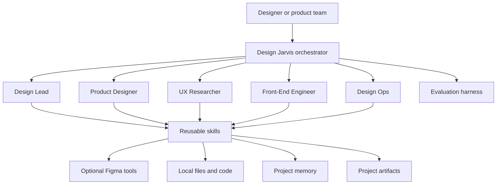

# Design Jarvis

Design Jarvis is an open-source, vendor-neutral AI design team for product and UX work. It combines specialist agents, reusable design skills, project memory, optional Figma integration, and a scenario-based evaluation harness.

The core system is plain Markdown, JSON, and JavaScript. Teams can adopt the whole workflow or reuse individual agents and skills in any compatible agent runtime.

## What it provides

- **Six agents:** an orchestrator plus Design Lead, Product Designer, UX Researcher, Front-End Engineer, and Design Ops specialists.
- **Reusable skills:** accessibility review, content review, competitive research, high-fidelity design, implementation, handoff specifications, design-system governance, and project memory.
- **Project workspaces:** artifacts live under `projects/<slug>/`; durable context lives under `.jarvis/memory/projects/<slug>/`.
- **Optional Figma integration:** inspect designs, create or update frames, capture prototypes, and connect components to code.
- **Quality gates:** deterministic checks and realistic scenarios verify routing, tool discipline, artifact placement, and completion evidence.
- **Open design-system model:** use the design system already present in a project, configure your own, or start with the neutral tokens in `projects/_starters/design-tokens.css`.

## Principles

1. **Vendor neutral.** No product, cloud, analytics platform, design system, or private knowledge service is assumed.
2. **Project context first.** Agents inspect the current product, code, design system, and prior decisions before proposing work.
3. **Artifacts over chat.** Specs, prototypes, diagrams, and decisions are saved in predictable project folders.
4. **Accessible by default.** WCAG 2.2 AA is the minimum quality target.
5. **Evidence before completion.** Design writes return node IDs and screenshots; code changes run builds and tests; research cites sources.
6. **Human judgment remains essential.** Generated work is a strong starting point, not a substitute for product context, user research, or craft review.

## Architecture



## Repository layout

```text
.github/agents/      Agent definitions and shared operating context
.github/skills/      Reusable task playbooks
.github/prompts/     Prompt shortcuts
.jarvis/memory/      Local project memory (ignored except templates)
projects/<slug>/     Project specs, prototypes, research, diagrams, and assets
projects/_starters/  Read-only, vendor-neutral starter templates
evals/               Scenario-based evaluation and loop engine
extensions/          Optional editor integration
scripts/             Repository checks and utilities
```

## Quick start

1. Clone or fork the repository: `git clone https://github.com/renfei-design/Design-Jarvis.git`.
2. Open it in an agent-capable development environment.
3. Select the Design Jarvis orchestrator, or copy the agent and skill files into your preferred runtime.
4. Optionally connect Figma using `.vscode/mcp.json`.
5. Start with a concrete request, for example:

```text
Create a UX brief for this product requirement, then propose the primary flow.
```

```text
Review this interface for hierarchy, accessibility, content clarity, and design-system fit.
```

```text
Build a working prototype under projects/account-settings/prototypes/ and verify its key states.
```

## Design-system configuration

Design Jarvis discovers design-system context in this order:

1. User-provided design-system documentation or Figma library.
2. Tokens and components in the current project.
3. Project memory and prior decisions.
4. Neutral starter tokens in `projects/_starters/design-tokens.css`.

No proprietary component library, font, color, or platform pattern is required.

## Verification

Run the local deterministic checks:

```bash
node evals/health-check.mjs
node evals/check-links.mjs
node --test 'evals/tests/*.test.mjs'
npm --prefix extensions/design-jarvis-pack run check
```

The end-to-end harness in `evals/README.md` grades realistic agent sessions. It evaluates behavior and evidence; it does not guarantee product correctness or final design quality.

## Contributing

Contributions should remain vendor-neutral, cite public sources when introducing guidance, keep project artifacts out of shared starters, and include proportional verification. See [CONTRIBUTING.md](CONTRIBUTING.md), [CODE_OF_CONDUCT.md](CODE_OF_CONDUCT.md), and `.github/PULL_REQUEST_TEMPLATE.md`.

Security reports should follow [SECURITY.md](SECURITY.md). Support and governance are described in [SUPPORT.md](SUPPORT.md) and [GOVERNANCE.md](GOVERNANCE.md). Redistributed material is documented in [THIRD_PARTY_NOTICES.md](THIRD_PARTY_NOTICES.md).

## License

MIT. See `LICENSE`.
